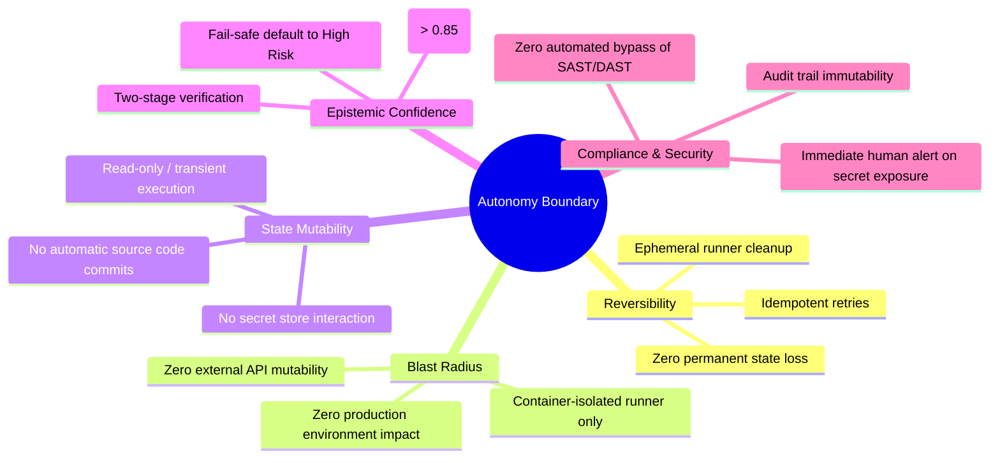

# CI/CD Incident Triage & Autonomy Escalation Policy

**Document Version:** 1.0.0  
**Status:** Approved Policy Specification  
**Application Domain:** Autonomous Incident Triage & Human-in-the-Loop DevOps / Platform Engineering  
**Research Context:** Master's Thesis – Safe Autonomy Boundaries in AIOps (Volvo Autonomous Solutions)

---

## 1. Governance Principles & Theoretical Foundations

In safety-critical and high-availability platform engineering, granting autonomous agency to AI systems introduces catastrophic risk if not bounded by deterministic guardrails. 

This escalation policy is constructed upon five foundational SRE and Systems Safety principles:

### 1.1 Action Reversibility (The Idempotency Criterion)
An autonomous remediation is permissible **only** if the action is mathematically idempotent and completely reversible without leaving side-effects in shared infrastructure, version control history, or production state. Retrying a transient HTTP test or clearing a local runner cache is 100% reversible. Committing a code fix or rolling back a database migration is not.

### 1.2 Blast Radius Bounding
The blast radius of any autonomous action must be strictly isolated to the single ephemeral CI runner container. If the agent acts erroneously, the worst-case consequence must be limited to an aborted ephemeral runner job—never corrupted cloud infrastructure, compromised secrets, or broken production traffic.

### 1.3 State Mutability Separation
A strict ontological boundary separates **Transient Actions** (retrying steps, purging ephemeral cache) from **State-Mutating Actions** (committing files, updating dependency lockfiles, changing infrastructure manifests, touching secrets). State-mutating actions strictly require human authorship and sign-off.

### 1.4 Epistemic Uncertainty & Fail-Safe Defaults
Whenever the AI agent encounters ambiguity, conflicting logs, or low classification confidence ($\text{Confidence} < 0.85$), the system **must fail-safe to Tier 3 (High Risk / Mandatory Escalation)**. An autonomous agent must never guess in low-confidence operational regimes.

### 1.5 Deterministic Governance Over AI Output
The LLM serves exclusively as an auxiliary reasoning and diagnostic engine. **No LLM output is ever directly wired to an execution runtime.** Every recommended remediation must be parsed, validated, and authorized by this deterministic Policy Engine before execution.

---

## 2. The Three-Tier Autonomy Classification Matrix

| Dimension | Tier 1: LOW RISK | Tier 2: MEDIUM RISK | Tier 3: HIGH RISK |
| :--- | :--- | :--- | :--- |
| **Operational Definition** | Transient, non-deterministic, or runner-environmental failures. | Deterministic code bugs, quality gate violations, dependency collisions. | Production releases, canary health failures, security vulnerabilities, secret leaks. |
| **Autonomy Authorization** | **AUTONOMOUS EXECUTION** (Closed-loop self-healing permitted). | **HUMAN-IN-THE-LOOP ASSISTED** (Agent diagnoses & drafts patch; Human reviews & approves). | **STRICT HUMAN ESCALATION ONLY** (Zero autonomous action; Pipeline frozen; Immediate alert). |
| **Allowed Actions** | `RETRY_JOB` `RERUN_FAILED_TESTS` `PURGE_CACHE_AND_RETRY` | `ESCALATE_WITH_PATCH_PROPOSAL` `CREATE_DEFECT_TICKET` `POST_PR_REVIEW_COMMENT` | `HALT_PIPELINE_AND_ALERT` `SECURITY_FREEZE` `NOTIFY_ON_CALL` |
| **Confidence Threshold** | $\ge 0.85$ (else escalates to Tier 3) | $\ge 0.70$ (else flagged as unclassified bug) | Any confidence $\to$ Always escalates |
| **Max Retry Limit** | 2 retries (Circuit Breaker enforced) | 0 (No retries) | 0 (No retries) |
| **Human Interaction** | Logged to asynchronous audit trail | Ticket generated for human developer sign-off | High-priority synchronous incident alert |

---

## 3. The Strict Invariant Prohibitions ("Never-Automate" Rules)

Under no circumstances—regardless of agent confidence (even $1.00$) or diagnostic clarity—shall the AI agent execute any action falling into the following invariant categories:

> [!CAUTION]
> **INVARIANT PROHIBITION 1: No Production or Staging Environment Mutation**  
> The agent shall NEVER trigger rollbacks, deployments, cluster restarts, or traffic shifts against live production or staging environments autonomously.

> [!CAUTION]
> **INVARIANT PROHIBITION 2: No Automated Source Code Commits**  
> The agent shall NEVER push commits directly to git branches or bypass pull-request branch protection rules. All code fixes must remain proposals for human engineers to review.

> [!CAUTION]
> **INVARIANT PROHIBITION 3: No Secret or Credential Handling**  
> The agent shall NEVER read, modify, persist, or transmit credentials, API tokens, or secrets. Upon detecting leaked credentials, the agent must sanitize all output and alert security immediately.

> [!CAUTION]
> **INVARIANT PROHIBITION 4: No Security Gate or Vulnerability Scan Bypass**  
> The agent shall NEVER override or ignore high/critical vulnerability findings (`pip-audit`, SAST, DAST) to force a green pipeline build.

---

## 4. Operational Guardrails & Circuit Breakers

### 4.1 Bounded Execution & Rate Limiting (Circuit Breaker)
To prevent infinite loops, resource waste, or cascading failures:
- An identical low-risk autonomous action may be executed at most **$N = 2$ times** per CI run.
- If the step fails after 2 autonomous retries, the policy engine automatically trips the circuit breaker, escalates the incident to **HIGH RISK**, and routes it to human on-call.

### 4.2 The Master Kill Switch
- The policy engine contains a top-level, fail-safe boolean toggle: `kill_switch_enabled`.
- When the kill switch is engaged (via environment variable `AUTONOMY_KILL_SWITCH=true` or emergency admin flag), **all autonomous execution is immediately revoked**.
- 100% of pipeline failures, including low-risk transient issues, are forced into human escalation mode.

---

## 5. Policy Engine Formal Decision Logic

The policy engine implements the deterministic function:
$$\text{PolicyDecision} = f(\text{Incident}, \text{Classification}, \text{Action}, \text{RetryCount}, \text{KillSwitch})$$

### Decision Rules:
1. **If `kill_switch_enabled == True`:**  
   $\to \text{DENY AUTONOMY}$, escalate with reason `"Master kill switch is ACTIVE. Autonomous actions suspended."`
2. **If `Action` in `PROHIBITED_ACTIONS`:**  
   $\to \text{DENY AUTONOMY}$, escalate with reason `"Action violates invariant safety policy."`
3. **If `RetryCount >= MAX_RETRIES (2)`:**  
   $\to \text{TRIP CIRCUIT BREAKER}$, escalate to Tier 3 with reason `"Exceeded maximum automated retry attempts."`
4. **If `PredictedTier == "LOW"` AND `Confidence >= 0.85` AND `Action` in `PERMITTED_LOW_RISK_ACTIONS`:**  
   $\to \text{ALLOW AUTONOMOUS EXECUTION}$, log compliance record.
5. **If `PredictedTier == "MEDIUM"`:**  
   $\to \text{ALLOW ASSISTED ESCALATION}$ (Generate structured patch/ticket, block execution).
6. **If `PredictedTier == "HIGH"` OR `Confidence < 0.85`:**  
   $\to \text{MANDATORY HUMAN ESCALATION}$ (Halt pipeline, trigger urgent alert).
